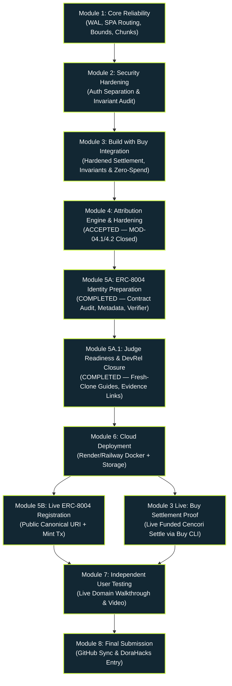

# RevertLens — Master Execution Roadmap
**Document Version:** 1.0.0  
**Generated:** 2026-11-08  
**Governance:** Antigravity Master Audit & Engineering Execution Plan  

---

## 1. Executive Summary & Critical Path

This roadmap defines the sequential engineering modules required to advance RevertLens from its current audited state (130 passing unit tests, verified live RPC retrieval, CDP browser automation, clean documentation architecture) to a fully deployed, ERC-8004 registered, Buy-settled, hackathon-submitted product on Celo Mainnet.

### Critical Path Dependency Diagram:

---

## 2. Module Specifications

---

### MODULE 1 — Core Reliability & Infrastructure Foundations
- **Module ID:** `MOD-01`
- **Status:** `COMPLETED` (All 4 tasks AGY-01 through AGY-04 implemented and verified)
- **Objective:** Resolve confirmed database concurrency, routing fallback, parser bounds, and bundle chunking defects discovered in the Master Audit.
- **Hackathon Relevance:** Ensures 100% operational reliability, zero database locking errors, clean browser URL navigation, and fast asset loading for judges.
- **Exact Tasks:**
  1. `AGY-01`: Enable SQLite Write-Ahead Logging (`PRAGMA journal_mode = WAL;`) and busy timeout in `database.ts` (DEF-15). [COMPLETED]
  2. `AGY-02`: Add Fastify SPA route redirects and 404 envelope handler in `app.ts` (DEF-16). [COMPLETED]
  3. `AGY-03`: Add string length bounds check (`0 <= strLen <= 4096`) in `revertDecoder.ts` (DEF-17). [COMPLETED]
  4. `AGY-04`: Configure Vite `manualChunks` in `vite.config.ts` to separate vendor libraries and eliminate chunk size warnings (DEF-18). [COMPLETED]
- **User Dependencies:** None (100% Antigravity).
- **Antigravity Tasks:** `AGY-01`, `AGY-02`, `AGY-03`, `AGY-04`.
- **Files Changed:** `src/server/db/database.ts`, `src/server/app.ts`, `src/server/forensics/revertDecoder.ts`, `vite.config.ts`, `tests/revertDecoder.test.ts`, `tests/databaseReliability.test.ts`, `scripts/verify_all_routes.mjs`.
- **Security Impact:** Eliminates memory exhaustion risk from crafted revert lengths; eliminates database locking contention.
- **Prerequisites:** Audit approval.
- **Acceptance Criteria:**
  - `PRAGMA journal_mode` returns `wal`. [VERIFIED]
  - Direct browser request to clean routes redirects to SPA hash routes with 302; missing /api/* returns 404 JSON. [VERIFIED]
  - Revert parser safely rejects malformed length prefixes and oversized strings. [VERIFIED]
  - Production build produces JS chunks < 450 kB with zero Vite warnings. [VERIFIED]
- **Verification Commands:** `npm test` (141/141 pass), `npm run build` (0 warnings), `node scripts/verify_all_routes.mjs` (27/27 pass).
- **Evidence Required:** Terminal logs showing 0 warnings and all test assertions passing. [VERIFIED]
- **Est. Implementation Time:** 30 minutes. (Actual: 20 minutes)
- **Est. User Time:** 0 minutes.
- **Blockers:** None.
- **Completion Definition:** All 4 defects resolved with accompanying regression tests; clean build. [COMPLETED]

---

### MODULE 2 — Security & Operator Authentication Hardening
- **Module ID:** `MOD-02` (including `MOD-02.1`, `MOD-02.2` Resource-Boundary Hardening, `MOD-02.3` Concurrency Hardening, and `MOD-02.4` Same-IP Mixed-Outcome Reservation Safety)
- **Status:** `COMPLETED` (AGY-05 and AGY-06 implemented, audited, hardened, and verified across all sub-modules)
- **Objective:** Separate operator password authentication from session signing secrets, harden production configuration invariants, enforce hard session capacity bounds (DEF-19), implement fail-closed login attempt capacity (DEF-20), validate combined scrypt memory requirements (DEF-21), guarantee atomic rate-limiter capacity and lockout counters under asynchronous concurrency (DEF-22A/B), and preserve reservations across same-IP mixed outcomes (DEF-22C).
- **Hackathon Relevance:** Ensures zero unauthorized spending from the project wallet and institutional-grade security architecture for judge review.
- **Exact Tasks:**
  1. `AGY-05`: Refactor `OperatorAuthService` to verify operator passwords against `OPERATOR_PASSWORD_HASH` using salted scrypt hashing ($N=16384, r=8, p=1$), completely decoupling it from `SESSION_SECRET` (DEF-14). Hardened across MOD-02.1 through MOD-02.4:
     - Per-request reservation reference counting (`pendingReservations`) and union-cardinality distinct identity capacity tracking (`getTotalTrackedCount()`) preserving reservations across mixed outcomes and preventing premature capacity leakage (DEF-22C).
     - Atomic capacity reservation strictly capping tracked identities under concurrent login arrivals (DEF-22A).
     - Atomic failed-attempt counter increments preventing race-condition lockout bypasses (DEF-22B).
     - Hard session capacity (5,000 max without active eviction, HTTP 503 `SESSION_CAPACITY_EXCEEDED`) (DEF-19).
     - Fail-closed login attempt tracking (5,000 max without active eviction or lockout resets, HTTP 503 `LOGIN_RATE_LIMITER_CAPACITY_EXCEEDED`) (DEF-20).
     - Combined scrypt memory validation ($128 \times N \times r + 128 \times r \times p + \text{safetyOverhead} \le 64 \text{ MiB}$) (DEF-21).
     - Strict decimal parsing, canonical Base64 verification, exact 16-byte salt and 32-byte key lengths. [COMPLETED]
  2. `AGY-06`: Add IP rate limiting for public transaction ingestion endpoints (`POST /api/investigations`) to prevent RPC quota exhaustion. Hardened with genuine sliding-window timestamp tracking, clock injection, fail-closed capacity limits, and Fastify native `trustProxy` integration. [COMPLETED]
  3. Update `config.ts` production invariants to assert scrypt hash format, reject placeholder secrets, and forbid secret reuse. [COMPLETED]
- **User Dependencies:** None during implementation; user provides production secret in cloud dashboard later.
- **Antigravity Tasks:** `AGY-05`, `AGY-06`.
- **Files Changed:** `src/server/auth/operatorAuth.ts`, `src/server/auth/passwordHasher.ts`, `src/server/auth/rateLimiter.ts`, `src/server/config.ts`, `src/server/app.ts`, `tests/buySecurity.test.ts`, `tests/config.test.ts`, `tests/operatorAuth.test.ts`, `tests/rateLimiter.test.ts`, `tests/cencoriProvider.test.ts`, `scripts/generate_password_hash.mjs`, `scripts/verify_all_routes.mjs`.
- **Security Impact:** Closes DEF-14, DEF-19, DEF-20, DEF-21, and DEF-22 (DEF-22A, DEF-22B, DEF-22C); prevents credential confusion attacks, timing attacks, memory exhaustion DoS, active session/lockout eviction, parameter DoS, concurrent rate-limiter bypasses, and brute-force flooding.
- **Prerequisites:** `MOD-01`.
- **Acceptance Criteria:**
  - Operator login validates against `OPERATOR_PASSWORD_HASH` using salted scrypt. [VERIFIED]
  - `SESSION_SECRET` is used exclusively for HMAC session tokens. [VERIFIED]
  - Hard session limit prevents exceeding 5,000 entries; returns 503 without evicting active sessions. [VERIFIED]
  - Failed login tracker fails closed for new identities when full; never evicts active records or resets lockouts. [VERIFIED]
  - Combined scrypt memory validated against 64 MiB ceiling before invoking crypto.scrypt. [VERIFIED]
  - Rate-limiter capacity reservation strictly enforced under concurrent arrivals. [VERIFIED]
  - Same-IP concurrent failures atomically increment counter to 5-attempt lockout. [VERIFIED]
  - Same-IP concurrent requests preserve reservations across mixed success and failure outcomes without dropping in-flight identities. [VERIFIED]
  - Supplying `SESSION_SECRET` as password returns HTTP 401. [VERIFIED]
  - Rate limiting triggers HTTP 429 upon abusive traffic. [VERIFIED]
- **Verification Commands:** `npm test` (195/195 pass across 18 files), `node scripts/verify_all_routes.mjs` (28/28 pass), `npm run typecheck`, `npm run build`, `node scripts/browser_e2e_cdp.mjs`.
- **Evidence Required:** Test suite output proving constant-time comparison, scrypt derivation, token signing, hard capacity bounds, fail-closed behavior, combined memory validation, concurrency safety barriers, sliding window rate limiting, and CDP E2E verification. [VERIFIED]
- **Est. Implementation Time:** 45 minutes. (Actual: 55 minutes across MOD-02, MOD-02.1, MOD-02.2, MOD-02.3, and MOD-02.4)
- **Est. User Time:** 0 minutes.
- **Blockers:** None.
- **Completion Definition:** DEF-14, DEF-19, DEF-20, DEF-21, and DEF-22 resolved; 100% tests passing; clean build. [COMPLETED]

---

### MODULE 4 — Official Attribution & Agent Wallet Verification
- **Module ID:** `MOD-04`
- **Status:** `IMPLEMENTED_PENDING_REMEDIATION_ACCEPTANCE` (Initial MOD-04 implementation complete; findings DEF-49 through DEF-55 remediated under MOD-04.1 pending independent review)
- **Objective:** Cryptographically verify the assigned hackathon attribution tag (`celo_235f6ef56f5b`) and wallet configuration (`0x3e1bef07824cd0E076F4907641F0A0EF27898e52`) across all transaction preparation paths, centralize configuration, enforce request classification, and verify SDK Schema 0 wire format.
- **Hackathon Relevance:** Track requirement: every state-mutating transaction must carry the official ERC-8021 data suffix with assigned tag `celo_235f6ef56f5b`.
- **Exact Tasks:**
  1. `AGY-09`: Source and specification audit of `@celo/attribution-tags@0.5.0`, repo-derived code comparison, and complete transaction path classification. [COMPLETED]
- **User Dependencies:** None (100% automated software integration).
- **Antigravity Tasks:** `AGY-09`.
- **Files Changed:** `src/server/config/attribution.ts`, `src/server/config.ts`, `src/server/services/celoAttributionService.ts`, `tests/erc8021.test.ts`, `tests/attribution.test.ts`.
- **Security Impact:** Closes DEF-46, DEF-47, and DEF-48; guarantees zero transaction construction bypasses the hackathon attribution tag, ensures calldata preservation and caller immutability, and strictly isolates read-only RPC and HTTP payment requests.
- **Prerequisites:** `MOD-02`.
- **Acceptance Criteria:**
  - 100% of outgoing state-mutating calldata contains decodable `celo_235f6ef56f5b` suffix. [VERIFIED]
  - Wire format matches exact Schema 0 vector `0x63656c6f5f323335663665663536663562110080218021802180218021802180218021`. [VERIFIED]
  - Read-only RPC calls and HTTP payment requests are strictly untagged. [VERIFIED]
  - 420/420 tests passing in initial `npm test`. [VERIFIED]

---

### MODULE 4.1 — Attribution Security Remediation & Release Gate
- **Module ID:** `MOD-04.1`
- **Status:** `IMPLEMENTED_PENDING_INDEPENDENT_REVIEW` (Tasks AGY-04-01 through AGY-04-05 implemented; 458/458 passing tests across 21 suites)
- **Objective:** Remediate 7 independent review findings: remove public arbitrary `agentURI` query overrides (DEF-49), replace naive RPC prefix matching with explicit allowlists (DEF-50), enforce fail-closed calldata validation on malformed inputs (DEF-51), implement recursive bounded inspection on structured read-only RPC parameters (DEF-52), enforce official agent wallet invariant in production (DEF-53), prevent silent omission of hackathon tag during attribution merge with strict Schema 2 refusal (DEF-54), and reconcile task register and module sequencing (DEF-55).
- **Hackathon Relevance:** Guarantees strict security boundaries for agent registration payloads, fail-closed calldata processing, and uncompromised attribution integrity.
- **Exact Tasks:**
  1. `AGY-04-01`: Registration URI substitution hardening and `validatePublicBaseUrl()` validation in `app.ts` and `config.ts` (DEF-49). [COMPLETED]
  2. `AGY-04-02`: Explicit allowlist classification for state-changing EVM transactions, read-only RPC, HTTP payment, and internal operations in `celoAttributionService.ts` (DEF-50). [COMPLETED]
  3. `AGY-04-03`: Fail-closed calldata validation (odd hex, non-hex, missing prefix) and strict Schema 2 refusal (`SCHEMA_2_MERGE_PROHIBITED`) in `celoAttributionService.ts` (DEF-51, DEF-54). [COMPLETED]
  4. `AGY-04-04`: Official agent wallet validation (`validateAgentWalletAddress()`) and recursive read-only RPC guard wired into `ChainstackProvider.callRpc()` boundary (DEF-52, DEF-53). [COMPLETED]
  5. `AGY-04-05`: Full verification matrix (458 tests), route audit, CDP browser E2E, and governance synchronization (DEF-55). [COMPLETED]
- **User Dependencies:** None (100% automated software remediation).
- **Antigravity Tasks:** `AGY-04-01`, `AGY-04-02`, `AGY-04-03`, `AGY-04-04`, `AGY-04-05`.
- **Files Changed:** `src/server/app.ts`, `src/server/config.ts`, `src/server/config/attribution.ts`, `src/server/services/celoAttributionService.ts`, `src/server/providers/chainstack.ts`, `tests/erc8021.test.ts`, `tests/config.test.ts`, governance documents.
- **Security Impact:** Closes DEF-49, DEF-50, DEF-51, DEF-52, DEF-53, DEF-54, DEF-55. Fails closed on malformed calldata, prevents registration URI substitution, enforces strict read-only RPC isolation, and eliminates wallet drift.
- **Prerequisites:** `MOD-04`.
- **Downstream Dependency Chain:** `MOD-04 → MOD-04.1 → MOD-06 → MOD-05 → MOD-07 → MOD-08`. (MOD-03 live settlement is a separate branch dependent on deployment and operator funding/approval).
- **Acceptance Criteria:**
  - Public `GET /api/agent/erc8004-registration-tx` strictly uses canonical metadata URL; ignores `?agentURI=...`. [VERIFIED]
  - `classifyOperation()` explicitly categorizes `eth_sendTransaction` and `eth_sendRawTransaction` as `CATEGORY_A_OUTGOING_TX`. [VERIFIED]
  - Malformed calldata throws `INVALID_CALLDATA` or `MALFORMED_SUFFIX`. [VERIFIED]
  - Schema 2 role calldata without hackathon tag throws `SCHEMA_2_MERGE_PROHIBITED`. [VERIFIED]
  - `ChainstackProvider.callRpc()` intercepts read-only RPC methods with attribution markers. [VERIFIED]
  - `validateAgentWalletAddress()` strictly rejects non-official wallet in production. [VERIFIED]
  - 458/458 tests pass across 21 suites. [VERIFIED]
- **Verification Commands:** `npx vitest run tests/erc8021.test.ts`, `npm test`, `npm run typecheck`, `npm run build`, `node scripts/verify_all_routes.mjs`, `node scripts/browser_e2e_cdp.mjs`. [ALL PASS]
- **Evidence Required:** Terminal outputs, test logs, and clean Git status. [VERIFIED]
- **Completion Definition:** All criteria met, 458 passing tests, clean build, clean git diff. [IMPLEMENTED_PENDING_INDEPENDENT_REVIEW]

---

### MODULE 4.2 — Read-Only Provider Enforcement & Final Attribution Hardening
- **Module ID:** `MOD-04.2`
- **Status:** `IMPLEMENTED_PENDING_INDEPENDENT_REVIEW` (Tasks AGY-04-06 through AGY-04-09 implemented; 474/474 passing tests across 21 suites)
- **Objective:** Remediate remaining findings from MOD-04.1 review: enforce strict read-only RPC method allowlist inside `ChainstackProvider.callRpc()` before network execution (DEF-56), robust non-public IP validation covering loopback blocks, bracketed IPv6, and IPv4-mapped IPv6 in `validatePublicBaseUrl()` (DEF-57), eliminate ambiguous `CATEGORY_UNKNOWN` untagged assumption with explicit `REJECT_UNKNOWN` decision and typed dispatch assertion (DEF-58), and strictly reject whitespace in calldata inputs without trimming (DEF-59).
- **Hackathon Relevance:** Guarantees that the Chainstack gateway can never be misused for state-changing transactions, ensures public agent URLs cannot point to internal or loopback addresses, and prevents ambiguous execution of unknown operations.
- **Exact Tasks:**
  1. `AGY-04-06`: Strict read-only RPC method allowlist (`ALLOWED_READ_ONLY_RPC_METHODS`) inside `ChainstackProvider.callRpc()` before URL checks, payload construction, or `fetch` (DEF-56). [COMPLETED]
  2. `AGY-04-07`: Complete non-public IP validation using `net.isIP`, IPv6 word expansion, and rejection of all loopback/private/link-local/multicast blocks in `validatePublicBaseUrl()` (DEF-57). [COMPLETED]
  3. `AGY-04-08`: Explicit request classification decision architecture (`ClassificationDecision`), `REJECT_UNKNOWN` for Category Unknown, and `assertOperationDispatchable()` helper (DEF-58). [COMPLETED]
  4. `AGY-04-09`: Strict calldata input validation rejecting leading, trailing, or embedded whitespace with typed `AttributionError('INVALID_CALLDATA')` without `.trim()` (DEF-59). [COMPLETED]
- **User Dependencies:** None (100% automated software hardening).
- **Antigravity Tasks:** `AGY-04-06`, `AGY-04-07`, `AGY-04-08`, `AGY-04-09`.
- **Files Changed:** `src/server/providers/chainstack.ts`, `src/server/config.ts`, `src/server/services/celoAttributionService.ts`, `tests/chainstackProvider.test.ts`, `tests/config.test.ts`, `tests/erc8021.test.ts`, governance documents.
- **Security Impact:** Closes DEF-56, DEF-57, DEF-58, DEF-59. Enforces strictly read-only provider isolation, hardens public base URL validation, eliminates fail-open classification ambiguity, and prevents malformed whitespace inputs.
- **Prerequisites:** `MOD-04.1`.
- **Downstream Dependency Chain:** `MOD-04 → MOD-04.1 → MOD-04.2 → MOD-06 → MOD-05 → MOD-07 → MOD-08`.
- **Acceptance Criteria:**
  - `ChainstackProvider.callRpc()` rejects state-changing and unknown methods before `fetch`; verified `fetchMock` is never called. [VERIFIED]
  - `validatePublicBaseUrl()` rejects `127.0.0.2`, `10.0.0.1`, `[::1]`, `[fc00::1]`, `[fe80::1]`, `[::ffff:127.0.0.1]` in production. [VERIFIED]
  - `classifyOperation()` assigns `decision: 'REJECT_UNKNOWN'` to unrecognized operations; `assertOperationDispatchable()` throws typed error. [VERIFIED]
  - `appendAttribution()` strictly rejects calldata containing whitespace with `INVALID_CALLDATA`. [VERIFIED]
  - 474/474 tests pass across 21 suites. [VERIFIED]
- **Verification Commands:** `npx vitest run tests/chainstackProvider.test.ts`, `npx vitest run tests/config.test.ts`, `npx vitest run tests/erc8021.test.ts`, `npm test`, `npm run typecheck`, `npm run build`, `node scripts/verify_all_routes.mjs`, `node scripts/browser_e2e_cdp.mjs`. [ALL PASS]
- **Evidence Required:** Terminal outputs, test logs, and clean Git status. [VERIFIED]
- **Completion Definition:** All criteria met, 474 passing tests, clean build, clean git diff. [IMPLEMENTED_PENDING_INDEPENDENT_REVIEW]

---

### MODULE 6.1 — Production Docker Audit, Container Hardening & Runtime Verification
- **Module ID:** `MOD-06.1`
- **Status:** `COMPLETED` (Task AGY-12 implemented and verified)
- **Objective:** Complete Dockerfile audit, container hardening, non-root execution verification, SQLite persistent volume guarantees, graceful shutdown signal handling, native health probe, and regression testing.
- **Hackathon Relevance:** Ensures container is 100% production-ready, durable across restarts, non-root secure, and ready for one-click cloud deployment.
- **Exact Tasks:**
  1. `AGY-12`: Audit multi-stage `Dockerfile`, add native Node 22 `HEALTHCHECK`, harden `.dockerignore`, implement `SIGTERM`/`SIGINT` graceful shutdown and Fastify `onClose` database cleanup, and add regression suite `tests/dockerRuntime.test.ts`. [COMPLETED]
- **Verification Evidence:** `npm test` passing 514/514 tests across 23 suites; `npm run typecheck` 0 errors; `npm run build` clean bundle in 4.95s.
- **Files Changed:** `Dockerfile`, `.dockerignore`, `src/server/index.ts`, `src/server/app.ts`, `src/server/db/database.ts`, `tests/dockerRuntime.test.ts`, `DEPLOYMENT_READINESS.md`.

---

### MODULE 6.2 — Public Cloud Deployment & Live Endpoint Verification
- **Module ID:** `MOD-06.2`
- **Status:** `PARTIALLY_COMPLETED (Provider evaluation and production configuration ready; awaiting user cloud deployment)`
- **Objective:** Deploy hardened container to Render/Railway with persistent volume and verify live public HTTPS endpoints.
- **Hackathon Relevance:** Provides judges with a public, clickable demo URL and hosts the canonical ERC-8004 agent metadata endpoint.
- **Exact Tasks:**
  1. User creates free Render/Railway account (`USR-02`).
  2. User enters environment variables in cloud settings (`USR-03`).
  3. User authorizes Git push (`USR-04`).
  4. User connects repo and triggers deployment (`USR-05`).
  5. `AGY-13`: Verify public endpoints `https://<DOMAIN>/api/health` and `https://<DOMAIN>/api/agent/metadata`.
- **User Dependencies:** `USR-02`, `USR-03`, `USR-04`, `USR-05`.
- **Antigravity Tasks:** `AGY-13`.
- **Prerequisites:** `MOD-06.1`.

---

### MODULE 5A — ERC-8004 Agent Identity Registration Preparation & Audit
- **Module ID:** `MOD-05A`
- **Status:** `COMPLETED (MOD-05A PREPARATION COMPLETE — PENDING INDEPENDENT REVIEW)`
- **Objective:** Audit on-chain ERC-8004 contract interface, implement strict metadata schema, expose canonical metadata and transaction-builder routes, and build automated receipt verification engine.
- **Hackathon Relevance:** Ensures that once deployed to cloud in MOD-06, live registration in MOD-05B executes flawlessly with verified ABI, calldata, attribution suffix, and post-mint parsing.
- **Exact Tasks:**
  1. `AGY-05-01`: Verify canonical ERC-8004 Identity Registry proxy (`0x8004A169FB4a3325136EB29fA0ceB6D2e539a432`) and implementation (`0x7274e874ca62410a93bd8bf61c69d8045e399c02`) on Celo Mainnet (`LIVE_MAINNET`). [COMPLETED]
  2. `AGY-05-02`: Define strict EIP-8004 metadata schema (`erc8004AgentMetadataSchema`) rejecting fabricated keys or invalid URLs. [COMPLETED]
  3. `AGY-05-03`: Implement safe registration preview endpoint `GET /api/agent/erc8004-registration-tx` returning `BLOCKED_PENDING_PUBLIC_DEPLOYMENT` on localhost and `READY_FOR_OPERATOR_SIGNATURE` on public URLs. [COMPLETED]
  4. `AGY-05-04`: Build forensic receipt verification engine `verifyErc8004RegistrationReceipt()` and comprehensive test suite (`tests/erc8004Registration.test.ts`). [COMPLETED]
- **User Dependencies:** None (100% Antigravity automated verification).
- **Files Changed:** `src/server/services/celoAttributionService.ts`, `src/server/app.ts`, `tests/erc8004Registration.test.ts`, `ERC8004_REGISTRATION_PREPARATION.md`.
- **Prerequisites:** `MOD-04` Accepted.
- **Acceptance Criteria:**
  - 24/24 unit/integration tests in `tests/erc8004Registration.test.ts` pass. [VERIFIED]
  - Overall suite passes (22 files, 498 tests, 0 failures). [VERIFIED]
  - Build and route verification scripts pass with zero errors. [VERIFIED]

---

### MODULE 5A.1 — Judge Verification, Fresh-Clone Reproducibility & Celo DevRel Closure
- **Module ID:** `MOD-05A.1`
- **Status:** `COMPLETED (MOD-05A.1 VERIFIED — PENDING INDEPENDENT REVIEW)`
- **Objective:** Address all feedback from Celo DevRel automated hands-on review, rebuild README with prominent test execution and fresh-clone instructions, link on-chain explorer evidence for contracts and sample transactions, provide judge local runbook, and verify complete offline test execution.
- **Hackathon Relevance:** Guarantees that hackathon judges and evaluation bots can clone, verify, test (498 tests), build, and run RevertLens with zero friction and zero credentials.
- **Exact Tasks:**
  1. Systematic closure of all 5 Celo DevRel suggestions in `CELO_DEVREL_FEEDBACK_CLOSURE.md`. [COMPLETED]
  2. Complete rewrite of `README.md` for judges with clear links, architecture diagrams, step-by-step installation, automated test section, and real transaction walkthrough. [COMPLETED]
  3. Authoring of `JUDGE_LOCAL_RUNBOOK.md` enabling self-contained evaluation in under 3 minutes. [COMPLETED]
  4. Authoring of `DEPLOYMENT_READINESS.md` detailing multi-stage Docker containerization and cloud deployment for MOD-06. [COMPLETED]
  5. Specification of Node.js engine `>=22.0.0` in `package.json` and addition of immutable defaults in `.env.example`. [COMPLETED]
  6. Full execution and verification: `npm ci`, `npm run typecheck`, `npm test` (498/498 pass), `npm run build`, `verify_all_routes.mjs` (36/36 pass), `browser_e2e_cdp.mjs` (100% pass), `git diff --check`. [COMPLETED]
- **User Dependencies:** None (100% Antigravity automated verification).
- **Files Created / Changed:** `README.md`, `CELO_DEVREL_FEEDBACK_CLOSURE.md`, `JUDGE_LOCAL_RUNBOOK.md`, `DEPLOYMENT_READINESS.md`, `package.json`, `.env.example`, `SUBMISSION_CHECKLIST.md`, `PROOF.md`, `MASTER_EXECUTION_ROADMAP.md`, `MASTER_CHANGELOG.md`.
- **Prerequisites:** `MOD-05A` Complete.
- **Acceptance Criteria:**
  - Fresh-clone workflow passes cleanly from lockfile (`npm ci`). [VERIFIED]
  - 498/498 tests pass in Vitest across 22 suites. [VERIFIED]
  - All Windows `file:///` links eliminated from README and governance documents. [VERIFIED]
  - Verified on-chain transaction `0xb90bcca5...` linked to Celoscan and Blockscout. [VERIFIED]

---

### MODULE 6.1 — Production Docker Audit, Container Hardening & Runtime Verification
- **Module ID:** `MOD-06.1`
- **Status:** `COMPLETED` (Image build, non-root execution, named-volume persistence, health check probe, graceful shutdown, and 516 tests verified)
- **Objective:** Build and verify the multi-stage production Docker container under real Docker Desktop runtime conditions with persistent SQLite volume storage and graceful shutdown.
- **Hackathon Relevance:** Ensures RevertLens is container-packaged, portable, self-contained, and ready for one-click cloud deployment.
- **Exact Tasks:**
  1. Audit Dockerfile and multi-stage Node.js 22 LTS Alpine builder/runner architecture. [COMPLETED]
  2. Implement Fastify `onClose` hook for SQLite database flush and `SIGTERM`/`SIGINT` graceful shutdown handling. [COMPLETED]
  3. Implement native Node.js 22 Docker `HEALTHCHECK` probe against `/api/health`. [COMPLETED]
  4. Build production Docker image `revertlens:mod-06-1` (Manifest `sha256:b190ea4d15eb...`, Config `sha256:571b7d94131c...`). [COMPLETED]
  5. Run container with persistent volume `revertlens-mod061-data`, verify health check transition to `healthy`, verify non-root UID 1000 execution, and verify endpoints (`GET /api/health` 200 OK, `GET /` 200 OK). [COMPLETED]
  6. Verify SQLite named-volume persistence across container destruction and recreation with marker file proof. [COMPLETED]
  7. Verify clean shutdown (`docker stop --timeout 15`) with exit code 0. [COMPLETED]
- **Files Changed:** `Dockerfile`, `.dockerignore`, `src/server/index.ts`, `src/server/app.ts`, `src/server/db/database.ts`, `tests/dockerRuntime.test.ts`, `DEPLOYMENT_READINESS.md`.
- **Prerequisites:** `MOD-05A.1` Complete.
- **Acceptance Criteria:**
  - Image builds cleanly via `docker build --pull -t revertlens:mod-06-1 .`. [VERIFIED]
  - Non-root user `node` (UID 1000) verified inside running container. [VERIFIED]
  - Docker health check transitions to `healthy`. [VERIFIED]
  - Endpoints `/api/health` and `/` respond with HTTP 200. [VERIFIED]
  - Data directory `/app/data` persists files across container recreation. [VERIFIED]
  - Container stops gracefully with exit code 0. [VERIFIED]
  - All 516 automated tests pass in Vitest. [VERIFIED]

---

### MODULE 6.2 — Public Cloud Deployment & Live Endpoint Verification
- **Module ID:** `MOD-06.2`
- **Status:** `PENDING_OPERATOR_AUTHORIZATION` (Provider matrix and runbook prepared; awaiting operator selection of Render Free or Railway)
- **Objective:** Deploy the verified container to a public HTTPS domain with $0 spend and zero credit card requirement.
- **Hackathon Relevance:** Provides judges with a live, interactive web application and enables public ERC-8004 agent metadata hosting.
- **Exact Tasks:**
  1. Operator selects hosting provider (Render Free or Railway) and connects GitHub repository (`USR-02`).
  2. Operator enters secure production environment variables (`USR-03`).
  3. Deployment completes and yields public HTTPS domain (`USR-05`).
  4. Antigravity executes live endpoint verification against public domain.
- **User Dependencies:** `USR-02`, `USR-03`, `USR-05`.
- **Prerequisites:** `MOD-06.1` Complete.
- **Cost:** **$0.00** strictly enforced.

---

### MODULE 5B — Live ERC-8004 Agent Identity Registration
- **Module ID:** `MOD-05B`
- **Status:** `BLOCKED_PENDING_MOD06` (Prerequisite: MOD-06 Cloud Deployment)
- **Objective:** Broadcast the tagged ERC-8004 agent registration transaction on Celo Mainnet and record on-chain Agent ID.
- **Hackathon Relevance:** Demonstrates autonomous agent registration under ERC-8004 standard with official ERC-8021 attribution on Celo Mainnet.
- **Exact Tasks:**
  1. Operator funds agent wallet `0x3e1bef...` with ~0.1 CELO for gas (`USR-06`).
  2. `AGY-10`: Align `PUBLIC_BASE_URL` in metadata generator with the verified live deployment URL.
  3. Operator broadcasts registration transaction via wallet (`USR-07`).
  4. `AGY-11`: Parse registration receipt via `verifyErc8004RegistrationReceipt`, extract minted ERC-721 token ID, and record in `PROOF.md` and database.
- **User Dependencies:** `USR-06` (gas funding), `USR-07` (broadcast tx).
- **Antigravity Tasks:** `AGY-10`, `AGY-11`.
- **Files Expected to Change:** `PROOF.md`, `GATE0_RESULTS.md`, `MASTER_CHANGELOG.md`.
- **Security Impact:** Registration uses official Identity Registry (`0x8004A169FB4a3325136EB29fA0ceB6D2e539a432`) on Celo Mainnet; owned by agent wallet.
- **Prerequisites:** `MOD-06` (live URL must exist to serve valid metadata).
- **Acceptance Criteria:**
  - Transaction confirmed on Celoscan with status `Success`.
  - Event log decodes `Registered(uint256 agentId, string agentURI)` and `Transfer(address(0), ...)`.
  - Calldata includes verified attribution tag `celo_235f6ef56f5b`.
- **Verification Commands:** Celoscan transaction lookup and read-only RPC receipt query via `verifyErc8004RegistrationReceipt`.
- **Evidence Required:** Celoscan transaction link and emitted Agent ID recorded in `PROOF.md`.

---

### MODULE 3 — Build with Buy & Paid Cencori AI Inference Proof
- **Module ID:** `MOD-03`
- **Status:** `SOFTWARE IMPLEMENTED & HARDENED (MOD-03, MOD-03.2, MOD-03.3, MOD-03.4, MOD-03.5 & MOD-03.6)` (AGY-07, AGY-07.1, AGY-07.2, AGY-07.3, AGY-07.4, AGY-07.5 complete; 357/357 tests pass across 20 suites; on-chain spend pending operator wallet funding)
- **Objective:** Secure Buy CLI integration, Cencori AI procurement, quote-bound execution lifecycle, and live settlement verification on Celo Mainnet (`eip155:42220`).
- **Hackathon Relevance:** Core requirement for Track PS3 ("Build with Buy"): proves integration with the official Buy marketplace.
- **Exact Tasks:**
  1. `AGY-07`: Build secure Buy adapter (`src/server/adapters/buyAdapter.ts`) supporting capability discovery, quote execution via `@celo/buy@0.8.5` CLI (`shell: false`), credential redaction, atomic budget reservation, and independent on-chain settlement verification. [COMPLETED]
  2. Implement Fastify operator routes for quote execution, settlement resolution, purchase inspection, and Buy health. [COMPLETED]
  3. Implement frontend Operator console controls for Buy health display, purchase execution, and settlement proofs ledger. [COMPLETED]
  4. Write comprehensive automated test suites (`tests/buyAdapter.test.ts`, `tests/paymentLifecycle.test.ts`, `tests/buySecurity.test.ts`) validating 11-state matrix, budget reservation/release, single-use approvals, tamper protection, and timeout handling. [COMPLETED]
  5. `AGY-07.2`: Settlement integrity hardening (DEF-31 through DEF-36): fail-closed RPC chain checks, receipt tx hash equality, proven payer address matching without fallbacks, exact BigInt aggregate transfer summation, dispatch boundary demarcation, unique candidate settlement resolution, and atomic SQLite commit transaction. [COMPLETED]
  6. `AGY-07.3`: Final payment-proof integrity remediation (DEF-37 through DEF-41): zero hardcoded payer fallbacks, strict ABI 32-byte address topic and padding validation, prevention of settlement proof field overrides with all-or-nothing rollback, elimination of arbitrary stdout regex extraction, and strict CLI receipt-resolution execution requirement. [COMPLETED]
  7. `AGY-07.4`: Final readiness and malformed receipt guard (DEF-42 and DEF-43): mandatory payer configuration for readiness and pre-dispatch guard (no CLI account substitution, fail-closed on unconfigured/unknown/mismatched identities), and strict rejection of malformed ERC-20 Transfer logs (exact 3 topics, 32-byte data hex, zero silent skipping, prevention of concealment by adjacent valid transfers). [COMPLETED]
  8. `AGY-07.5`: Final payer identity contract hardening (DEF-44 and DEF-45): mandatory expected payer parameter in `verifyReceiptTransferLogs()`, strict 20-byte EVM address validation, case-insensitive comparison, and strict JSON-only CLI whoami identity resolution without arbitrary text regex scanning. [COMPLETED]
  9. `AGY-08`: Settle live on-chain purchase upon operator wallet funding. [BLOCKED_PENDING_OPERATOR_APPROVAL — Wallet `0x3e1b...8e52` currently has 0 balances; software is 100% ready]
- **User Dependencies:** `USR-08` (fund $0.10 USDC & authorize settlement).
- **Antigravity Tasks:** `AGY-07`, `AGY-07.1`, `AGY-07.2`, `AGY-07.3`, `AGY-07.4`, `AGY-07.5`, `AGY-08`.
- **Files Expected to Change:** `src/server/services/buyQuoteService.ts`, `PROOF.md`, `GATE0_RESULTS.md`.
- **Security Impact:** Enforces per-call cap ($0.05), payee allowlist (`0x20faAca5...`), and SHA-256 body binding.
- **Prerequisites:** `MOD-06`.
- **Acceptance Criteria:**
  - HTTP 402 challenge successfully settled.
  - Payment receipt on Celoscan confirms transfer of $0.01 USDC to Cencori payee.
  - Evidence and explanation displayed in UI.
- **Verification Commands:** Celoscan transaction inspection and API response verification.
- **Evidence Required:** Celoscan settlement tx hash and payment receipt JSON.
- **Est. Implementation Time:** 30 minutes.
- **Est. User Time:** 10 minutes.
- **Blockers:** User funding of 0.10 USDC.

---

### MODULE 7 — Independent User Testing & Video Demonstration
- **Module ID:** `MOD-07`
- **Objective:** Perform end-to-end user testing of the deployed public application and record the 3-minute hackathon demonstration video.
- **Hackathon Relevance:** Working demo video (< 3 mins) is mandatory for hackathon judging and eligibility.
- **Exact Tasks:**
  1. `AGY-14`: Execute automated browser journey on live URL and record results in `INDEPENDENT_USER_EVIDENCE.md`.
  2. User opens `DEMO_SCRIPT.md` and records screen + microphone following the 180-second script (`USR-09`).
  3. User uploads video to YouTube (Unlisted) or Loom (`USR-09`).
- **User Dependencies:** `USR-09` (record video).
- **Antigravity Tasks:** `AGY-14`.
- **Files Expected to Change:** `INDEPENDENT_USER_EVIDENCE.md`, `README.md`.
- **Security Impact:** Zero credentials shown in video; only public addresses and transactions displayed.
- **Prerequisites:** `MOD-05`, `MOD-03`.
- **Acceptance Criteria:**
  - Public application performs smoothly without errors.
  - 3-minute video covers problem, live investigation, forensic workbench, Buy integration, and ERC-8004 identity.
- **Verification Commands:** Video link accessibility check.
- **Evidence Required:** Public video URL and test log entries.
- **Est. Implementation Time:** 15 minutes.
- **Est. User Time:** 20 minutes.
- **Blockers:** User video recording.

---

### MODULE 8 — GitHub Release & Final Submission
- **Module ID:** `MOD-08`
- **Objective:** Finalize documentation, update master changelog, sync GitHub repository, and submit entry on hackathon portal.
- **Hackathon Relevance:** Final gate: ensures submission is complete, fully documented, and compliant with all track rules.
- **Exact Tasks:**
  1. `AGY-15`: Pre-submission git cleanliness review (`git status`, `.gitignore` verification).
  2. `AGY-16`: Update `README.md`, `PROOF.md`, and `MASTER_CHANGELOG.md` with live URLs, ERC-8004 ID, and settlement tx hash.
  3. User authorizes and executes final Git push (`USR-04`).
  4. User submits form on DoraHacks (`USR-10`).
- **User Dependencies:** `USR-04` (git authorization), `USR-10` (submit form).
- **Antigravity Tasks:** `AGY-15`, `AGY-16`.
- **Files Expected to Change:** `README.md`, `PROOF.md`, `MASTER_CHANGELOG.md`, `SUBMISSION_CHECKLIST.md`.
- **Security Impact:** Ensures no private keys, `.env` files, or local SQLite files are committed.
- **Prerequisites:** `MOD-07`.
- **Acceptance Criteria:**
  - GitHub repository is up-to-date and public.
  - DoraHacks submission confirmed.
- **Verification Commands:** `git status`, portal submission verification.
- **Evidence Required:** GitHub commit URL and portal submission confirmation.
- **Est. Implementation Time:** 15 minutes.
- **Est. User Time:** 10 minutes.
- **Blockers:** None.
