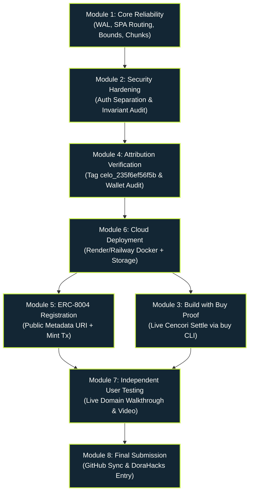

# RevertLens — Master Execution Roadmap
**Document Version:** 1.0.0  
**Generated:** 2026-11-08  
**Governance:** Antigravity Master Audit & Engineering Execution Plan  

---

## 1. Executive Summary & Critical Path

This roadmap defines the sequential engineering modules required to advance RevertLens from its current audited state (130 passing unit tests, verified live RPC retrieval, CDP browser automation, clean documentation architecture) to a fully deployed, ERC-8004 registered, Buy-settled, hackathon-submitted product on Celo Mainnet.

### Critical Path Dependency Diagram:

---

## 2. Module Specifications

---

### MODULE 1 — Core Reliability & Infrastructure Foundations
- **Module ID:** `MOD-01`
- **Status:** `COMPLETED` (All 4 tasks AGY-01 through AGY-04 implemented and verified)
- **Objective:** Resolve confirmed database concurrency, routing fallback, parser bounds, and bundle chunking defects discovered in the Master Audit.
- **Hackathon Relevance:** Ensures 100% operational reliability, zero database locking errors, clean browser URL navigation, and fast asset loading for judges.
- **Exact Tasks:**
  1. `AGY-01`: Enable SQLite Write-Ahead Logging (`PRAGMA journal_mode = WAL;`) and busy timeout in `database.ts` (DEF-15). [COMPLETED]
  2. `AGY-02`: Add Fastify SPA route redirects and 404 envelope handler in `app.ts` (DEF-16). [COMPLETED]
  3. `AGY-03`: Add string length bounds check (`0 <= strLen <= 4096`) in `revertDecoder.ts` (DEF-17). [COMPLETED]
  4. `AGY-04`: Configure Vite `manualChunks` in `vite.config.ts` to separate vendor libraries and eliminate chunk size warnings (DEF-18). [COMPLETED]
- **User Dependencies:** None (100% Antigravity).
- **Antigravity Tasks:** `AGY-01`, `AGY-02`, `AGY-03`, `AGY-04`.
- **Files Changed:** `src/server/db/database.ts`, `src/server/app.ts`, `src/server/forensics/revertDecoder.ts`, `vite.config.ts`, `tests/revertDecoder.test.ts`, `tests/databaseReliability.test.ts`, `scripts/verify_all_routes.mjs`.
- **Security Impact:** Eliminates memory exhaustion risk from crafted revert lengths; eliminates database locking contention.
- **Prerequisites:** Audit approval.
- **Acceptance Criteria:**
  - `PRAGMA journal_mode` returns `wal`. [VERIFIED]
  - Direct browser request to clean routes redirects to SPA hash routes with 302; missing /api/* returns 404 JSON. [VERIFIED]
  - Revert parser safely rejects malformed length prefixes and oversized strings. [VERIFIED]
  - Production build produces JS chunks < 450 kB with zero Vite warnings. [VERIFIED]
- **Verification Commands:** `npm test` (141/141 pass), `npm run build` (0 warnings), `node scripts/verify_all_routes.mjs` (27/27 pass).
- **Evidence Required:** Terminal logs showing 0 warnings and all test assertions passing. [VERIFIED]
- **Est. Implementation Time:** 30 minutes. (Actual: 20 minutes)
- **Est. User Time:** 0 minutes.
- **Blockers:** None.
- **Completion Definition:** All 4 defects resolved with accompanying regression tests; clean build. [COMPLETED]

---

### MODULE 2 — Security & Operator Authentication Hardening
- **Module ID:** `MOD-02`
- **Objective:** Separate operator password authentication from session signing secrets and harden production configuration invariants.
- **Hackathon Relevance:** Ensures zero unauthorized spending from the project wallet and institutional-grade security architecture for judge review.
- **Exact Tasks:**
  1. `AGY-05`: Refactor `OperatorAuthService` to compare operator passwords against `OPERATOR_PASSWORD_HASH` using salted cryptographic hashing (PBKDF2/scrypt/Argon2id), decoupling it from `SESSION_SECRET` (DEF-14).
  2. `AGY-06`: Add IP rate limiting for public transaction ingestion endpoints to prevent RPC quota exhaustion.
  3. Update `config.ts` production invariants to assert password hash and session secret separation.
- **User Dependencies:** None during implementation; user provides production secret in cloud dashboard later.
- **Antigravity Tasks:** `AGY-05`, `AGY-06`.
- **Files Expected to Change:** `src/server/auth/operatorAuth.ts`, `src/server/config.ts`, `src/server/app.ts`, `tests/buySecurity.test.ts`.
- **Security Impact:** Closes DEF-14; prevents credential confusion attacks and strengthens operator session isolation.
- **Prerequisites:** `MOD-01`.
- **Acceptance Criteria:**
  - Operator login validates against `OPERATOR_PASSWORD_HASH`.
  - `SESSION_SECRET` is used exclusively for HMAC session tokens.
  - Rate limiting triggers HTTP 429 upon abusive traffic.
- **Verification Commands:** `npx vitest run tests/buySecurity.test.ts`, `node scripts/verify_all_routes.mjs`.
- **Evidence Required:** Test suite output proving constant-time comparison and proper credential validation.
- **Est. Implementation Time:** 45 minutes.
- **Est. User Time:** 0 minutes.
- **Blockers:** None.

---

### MODULE 4 — Official Attribution & Agent Wallet Verification
- **Module ID:** `MOD-04`
- **Objective:** Cryptographically verify the assigned hackathon attribution tag and wallet configuration across all transaction preparation paths.
- **Hackathon Relevance:** Track requirement: every state-mutating transaction must carry the official ERC-8021 data suffix with assigned tag `celo_235f6ef56f5b`.
- **Exact Tasks:**
  1. User confirms wallet `0x3e1bef07824cd0E076F4907641F0A0EF27898e52` and tag `celo_235f6ef56f5b` (`USR-01`).
  2. `AGY-09`: Audit `CeloAttributionService` to verify that `toDataSuffix('celo_235f6ef56f5b')` produces exact decodable bytecode and that read-only RPC calls (`eth_call`, `eth_getTransactionReceipt`, etc.) remain untagged.
  3. Run live RPC balance check on agent wallet to document pre-funding state.
- **User Dependencies:** `USR-01` (confirm registration tag & wallet).
- **Antigravity Tasks:** `AGY-09`.
- **Files Expected to Change:** `tests/attribution.test.ts`, `PROOF.md`.
- **Security Impact:** Guarantees zero transaction construction bypasses the hackathon attribution tag.
- **Prerequisites:** `MOD-02`.
- **Acceptance Criteria:**
  - 100% of outgoing state-mutating calldata contains decodable `celo_235f6ef56f5b` suffix.
  - Read-only RPC calls are strictly untagged.
- **Verification Commands:** `npx vitest run tests/attribution.test.ts`.
- **Evidence Required:** Decoded calldata assertions and on-chain RPC balance record.
- **Est. Implementation Time:** 15 minutes.
- **Est. User Time:** 3 minutes.
- **Blockers:** None.

---

### MODULE 6 — Cloud Deployment & Public Infrastructure Setup
- **Module ID:** `MOD-06`
- **Objective:** Deploy RevertLens to a high-availability cloud platform (Render/Railway) with persistent storage and HTTPS.
- **Hackathon Relevance:** Provides judges with a public, clickable, responsive demo URL and hosts the ERC-8004 agent metadata endpoint.
- **Exact Tasks:**
  1. `AGY-12`: Audit multi-stage `Dockerfile` and ensure compatibility with Render/Railway Docker runtime.
  2. User creates free Render/Railway account (`USR-02`).
  3. User enters environment variables in cloud settings (`USR-03`).
  4. User authorizes Git push (`USR-04`).
  5. User connects repo and triggers deployment (`USR-05`).
  6. `AGY-13`: Verify public endpoints `https://<DOMAIN>/api/health` and `https://<DOMAIN>/api/agent/metadata`.
- **User Dependencies:** `USR-02`, `USR-03`, `USR-04`, `USR-05`.
- **Antigravity Tasks:** `AGY-12`, `AGY-13`.
- **Files Expected to Change:** `Dockerfile`, `DEPLOYMENT_READINESS.md`, `README.md`.
- **Security Impact:** Production environment variables stored securely in cloud vault; zero credentials in Git.
- **Prerequisites:** `MOD-04`.
- **Acceptance Criteria:**
  - Public `/api/health` returns `200 OK` with `chainId: 42220`.
  - Public SPA loads cleanly on desktop and mobile browsers.
  - Persistent SQLite volume retains investigations across server restarts.
- **Verification Commands:** `curl -s https://<DOMAIN>/api/health`, `curl -s https://<DOMAIN>/api/agent/metadata`.
- **Evidence Required:** HTTP response headers and JSON body from live public domain.
- **Est. Implementation Time:** 20 minutes.
- **Est. User Time:** 15 minutes.
- **Blockers:** User cloud account creation.

---

### MODULE 5 — ERC-8004 Agent Identity Registration
- **Module ID:** `MOD-05`
- **Objective:** Broadcast the tagged ERC-8004 agent registration transaction on Celo Mainnet and record on-chain Agent ID.
- **Hackathon Relevance:** Demonstrates autonomous agent registration under ERC-8004 standard with official ERC-8021 attribution on Celo Mainnet.
- **Exact Tasks:**
  1. User funds agent wallet `0x3e1bef...` with 0.05 CELO gas (`USR-06`).
  2. `AGY-10`: Align `PUBLIC_BASE_URL` in metadata generator with the verified live deployment URL.
  3. User broadcasts registration transaction via wallet (`USR-07`).
  4. `AGY-11`: Parse registration receipt on Celoscan, extract minted ERC-721 token ID, and record in `PROOF.md` and database.
- **User Dependencies:** `USR-06` (gas funding), `USR-07` (broadcast tx).
- **Antigravity Tasks:** `AGY-10`, `AGY-11`.
- **Files Expected to Change:** `PROOF.md`, `GATE0_RESULTS.md`, `MASTER_CHANGELOG.md`.
- **Security Impact:** Registration uses official Identity Registry (`0x8004A169FB4a3325136EB29fA0ceB6D2e539a432`) on Celo Mainnet; owned by agent wallet.
- **Prerequisites:** `MOD-06` (live URL must exist to serve valid metadata).
- **Acceptance Criteria:**
  - Transaction confirmed on Celoscan with status `Success`.
  - Event log decodes `Registered(uint256 agentId, string agentURI)`.
  - Calldata includes verified attribution tag `celo_235f6ef56f5b`.
- **Verification Commands:** Celoscan transaction lookup and read-only RPC receipt query.
- **Evidence Required:** Celoscan transaction link and emitted Agent ID.
- **Est. Implementation Time:** 20 minutes.
- **Est. User Time:** 10 minutes.
- **Blockers:** Gas funding and human transaction broadcast.

---

### MODULE 3 — Build with Buy & Paid Cencori AI Inference Proof
- **Module ID:** `MOD-03`
- **Objective:** Execute and verify one live paid Cencori AI inference transaction via `@celo/buy` on Celo Mainnet.
- **Hackathon Relevance:** Core requirement for Track PS3 ("Build with Buy"): proves integration with the official Buy marketplace.
- **Exact Tasks:**
  1. `AGY-07`: Wire execution adapter to invoke `buy curl` upon operator approval with strict spending caps.
  2. User funds Buy CLI wallet with 0.10 USDC on Celo Mainnet (`USR-08`).
  3. User/Operator executes one live Cencori AI forensic explanation query (`USR-08`).
  4. `AGY-08`: Verify settlement payment receipt on Celoscan, record tx hash in `PROOF.md` and `GATE0_RESULTS.md`.
- **User Dependencies:** `USR-08` (fund $0.10 USDC & authorize settlement).
- **Antigravity Tasks:** `AGY-07`, `AGY-08`.
- **Files Expected to Change:** `src/server/services/buyQuoteService.ts`, `PROOF.md`, `GATE0_RESULTS.md`.
- **Security Impact:** Enforces per-call cap ($0.05), payee allowlist (`0x20faAca5...`), and SHA-256 body binding.
- **Prerequisites:** `MOD-06`.
- **Acceptance Criteria:**
  - HTTP 402 challenge successfully settled.
  - Payment receipt on Celoscan confirms transfer of $0.01 USDC to Cencori payee.
  - Evidence and explanation displayed in UI.
- **Verification Commands:** Celoscan transaction inspection and API response verification.
- **Evidence Required:** Celoscan settlement tx hash and payment receipt JSON.
- **Est. Implementation Time:** 30 minutes.
- **Est. User Time:** 10 minutes.
- **Blockers:** User funding of 0.10 USDC.

---

### MODULE 7 — Independent User Testing & Video Demonstration
- **Module ID:** `MOD-07`
- **Objective:** Perform end-to-end user testing of the deployed public application and record the 3-minute hackathon demonstration video.
- **Hackathon Relevance:** Working demo video (< 3 mins) is mandatory for hackathon judging and eligibility.
- **Exact Tasks:**
  1. `AGY-14`: Execute automated browser journey on live URL and record results in `INDEPENDENT_USER_EVIDENCE.md`.
  2. User opens `DEMO_SCRIPT.md` and records screen + microphone following the 180-second script (`USR-09`).
  3. User uploads video to YouTube (Unlisted) or Loom (`USR-09`).
- **User Dependencies:** `USR-09` (record video).
- **Antigravity Tasks:** `AGY-14`.
- **Files Expected to Change:** `INDEPENDENT_USER_EVIDENCE.md`, `README.md`.
- **Security Impact:** Zero credentials shown in video; only public addresses and transactions displayed.
- **Prerequisites:** `MOD-05`, `MOD-03`.
- **Acceptance Criteria:**
  - Public application performs smoothly without errors.
  - 3-minute video covers problem, live investigation, forensic workbench, Buy integration, and ERC-8004 identity.
- **Verification Commands:** Video link accessibility check.
- **Evidence Required:** Public video URL and test log entries.
- **Est. Implementation Time:** 15 minutes.
- **Est. User Time:** 20 minutes.
- **Blockers:** User video recording.

---

### MODULE 8 — GitHub Release & Final Submission
- **Module ID:** `MOD-08`
- **Objective:** Finalize documentation, update master changelog, sync GitHub repository, and submit entry on hackathon portal.
- **Hackathon Relevance:** Final gate: ensures submission is complete, fully documented, and compliant with all track rules.
- **Exact Tasks:**
  1. `AGY-15`: Pre-submission git cleanliness review (`git status`, `.gitignore` verification).
  2. `AGY-16`: Update `README.md`, `PROOF.md`, and `MASTER_CHANGELOG.md` with live URLs, ERC-8004 ID, and settlement tx hash.
  3. User authorizes and executes final Git push (`USR-04`).
  4. User submits form on DoraHacks (`USR-10`).
- **User Dependencies:** `USR-04` (git authorization), `USR-10` (submit form).
- **Antigravity Tasks:** `AGY-15`, `AGY-16`.
- **Files Expected to Change:** `README.md`, `PROOF.md`, `MASTER_CHANGELOG.md`, `SUBMISSION_CHECKLIST.md`.
- **Security Impact:** Ensures no private keys, `.env` files, or local SQLite files are committed.
- **Prerequisites:** `MOD-07`.
- **Acceptance Criteria:**
  - GitHub repository is up-to-date and public.
  - DoraHacks submission confirmed.
- **Verification Commands:** `git status`, portal submission verification.
- **Evidence Required:** GitHub commit URL and portal submission confirmation.
- **Est. Implementation Time:** 15 minutes.
- **Est. User Time:** 10 minutes.
- **Blockers:** None.
