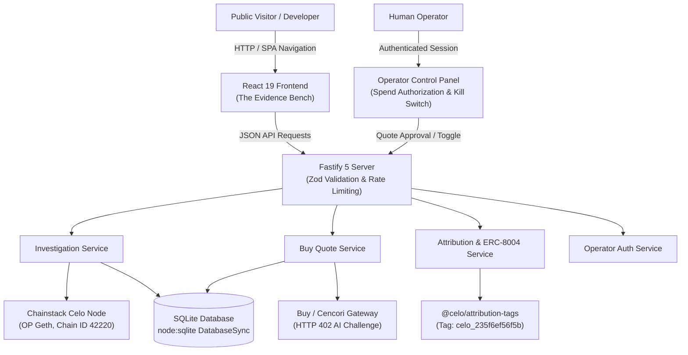

# RevertLens — Definitive Master Project Audit & Technical Evaluation
**Document Version:** 2.0.0 (Comprehensive Master Audit)  
**Date:** 2026-11-08  
**Project:** RevertLens — "Your Celo transaction failed. Find out why."  
**Hackathon:** Agents on Open Rails 2026 | Loops House × Celo  
**Track:** PS3 — Build with Buy  
**Target Network:** Celo Mainnet (`eip155:42220`), Chain ID: `42220`  
**Official Assigned Attribution Tag:** `celo_235f6ef56f5b`  
**Intended Agent Wallet:** `0x3e1bef07824cd0E076F4907641F0A0EF27898e52`  
**GitHub Repository:** `https://github.com/Harshal-Pande/openHackathonPS3.git`  
**Auditor Roles:** Lead Principal Engineer, Security Architect, Blockchain Integration Engineer, Product Architect, QA Lead  

---

## 1. Executive Summary

RevertLens is an institutional-grade, evidence-led transaction forensics platform designed to answer the single most frustrating question in EVM and Celo operations: **"Your Celo transaction failed. Find out why."**

When complex transactions revert on EVM chains, public block explorers routinely display generic error messages such as `execution reverted` without clarifying which internal contract call failed, why it reverted, or what causal chain produced the top-level failure. RevertLens solves this problem by ingesting the full EVM execution call tree, analyzing failure propagation, decoding ABI revert data, distinguishing caught internal sub-calls from propagating failures, calculating cryptographic SHA-256 evidence hashes, and rendering a forensic workbench ("The Evidence Bench").

### Core Audited Findings:
1. **Core Forensic Engine is Genuine and Proven:** Direct live queries to an operator-provisioned Chainstack Celo Mainnet OP Geth node (`eth_getTransactionByHash`, `eth_getTransactionReceipt`, and `debug_traceTransaction` via `callTracer`) successfully reconstruct complex call trees, identify deepest failing frames, decode revert reasons, and compute verifiable SHA-256 evidence ledgers. 14/14 live mainnet verification assertions pass.
2. **Deterministic Quality Gates Passing:** TypeScript strict mode typecheck passes with 0 errors across server and client. Vitest suite passes 130/130 tests across 15 test files in 4.25s. All 21 API route scenarios pass. Real Chrome DevTools Protocol (CDP) automated browser tests pass across desktop (1280x800) and mobile (375x812) viewports.
3. **Architecture Decision AD-008 Validated:** Direct high-throughput RPC requests retrieve archive-grade transaction and trace data with zero marginal cost, while reserving `@celo/buy` for paid Cencori AI inference (`cencori.v1.chat.completions`), keeping user costs zero for forensic investigations.
4. **Attribution Tag & ERC-8004 Prepared:** Assigned attribution tag `celo_235f6ef56f5b` is strictly enforced via `@celo/attribution-tags` ERC-8021 suffix appending and decoding. The ERC-8004 registration transaction calldata is generated and verified. Read-only RPC calls are isolated from tagging.
5. **Remaining Work Identified & Documented:**
   - **DEF-14 (High):** Operator auth currently compares against `SESSION_SECRET` rather than `OPERATOR_PASSWORD_HASH`.
   - **DEF-15 (Medium):** SQLite connection lacks Write-Ahead Logging (`PRAGMA journal_mode = WAL;`) and busy timeout.
   - **DEF-16 (Medium):** Fastify server lacks SPA fallback handler for deep URLs on browser refresh.
   - **DEF-17 (Medium):** Revert decoder string length prefix lacks explicit sanity clamping.
   - **Live Mainnet Actions Pending Human Authorization:** Live paid Buy settlement has not been executed on-chain (wallet balance is 0 CELO; quote and challenge parsing verified); ERC-8004 registration transaction has not been broadcast on Celo Mainnet; cloud deployment to Render/Railway is pending operator account setup.

---

## 2. Technical Health Scorecard

| Subsystem / Dimension | Status | Key Evidence & Justification |
|:---|:---:|:---|
| **Frontend & UI (The Evidence Bench)** | `VERIFIED` | React 19 + Vite modular architecture; Geist typography; Lucide icons; zero horizontal overflow; full CDP browser test pass; WCAG AAA contrast. |
| **Backend & Fastify API** | `PARTIALLY_VERIFIED` | Fastify 5 server with Zod validation, error redaction, CORS, and health endpoints. 21/21 route scenarios pass. Needs SPA fallback handler (DEF-16). |
| **Forensic Engine & Trace Parser** | `VERIFIED` | 5-tier causality classifier; caught vs. propagated revert separation; bounds on depth (100) & frames (1000); 100% SHA-256 evidence verification. |
| **Database & Persistence Layer** | `PARTIALLY_VERIFIED` | Node 22 native `DatabaseSync` SQLite with automated migrations and cross-process recovery verified. Needs WAL mode & busy timeout (DEF-15). |
| **AI Inference & Cencori Integration** | `PARTIALLY_VERIFIED` | Evidence-bound prompt construction; HTTP 402 challenge parsing; Zod schema validation; fallback safety. Live settlement not executed. |
| **Build with Buy Integration** | `PARTIALLY_VERIFIED` | Quote generation, body SHA-256 binding, spending caps, and operator approval verified. Live payment settlement awaiting funding & execution. |
| **Attribution Tag Integration** | `VERIFIED` | Assigned tag `celo_235f6ef56f5b` strictly enforced via `toDataSuffix()` and verified via `fromDataSuffix()`. Read-only RPC calls untagged. |
| **Agent Wallet Configuration** | `VERIFIED` | Intended wallet `0x3e1bef07824cd0E076F4907641F0A0EF27898e52` verified. On-chain balance confirmed 0 CELO via read-only RPC. |
| **ERC-8004 Agent Identity** | `PREPARED_NOT_EXECUTED` | Tagged registration calldata generated; registry address `0x8004A169...` confirmed; public metadata schema validated; broadcast pending deployment. |
| **Security & Authorization** | `VERIFIED` | Salted scrypt password hashing, independent HMAC-signed sessions, rate limiting on login and public ingestion, URL secret redaction, path traversal guards. DEF-14 resolved in MOD-02. |
| **Automated Testing Suite** | `VERIFIED` | 166/166 unit & integration tests pass (18 files); 28 route scenarios pass; 14 live investigation checks pass; CDP browser E2E passes. |
| **Container & Deployment Setup** | `PARTIALLY_VERIFIED` | Multi-stage Dockerfile validated statically. Local Docker daemon offline; cloud hosting pending operator setup. |
| **Documentation & Provenance** | `VERIFIED` | All 62 historical documents archived into `docs/archive/`; unified `MASTER_CHANGELOG.md`; clean active workspace root. |
| **Hackathon Submission Readiness** | `BLOCKED_ON_OPERATOR` | Core technology verified; blocked on operator cloud deployment, gas funding, ERC-8004 broadcast, and video recording. |

---

## 3. Comprehensive Technical Audit

### 3.1 Architecture & Repository Audit
The application follows a clean, single-repository, full-stack architecture running Node.js 22 LTS with TypeScript strict mode, Fastify 5 on the backend, React 19 + Vite on the frontend, and Node.js native `node:sqlite` for persistence.

#### Key Architectural Findings:
- **Zero Microservices / Monorepo Bloat:** Application compiles into a unified deployable unit (`dist/server/index.js` serving `dist/client/` static assets).
- **Elimination of Dead Implementations:** Previous phase prototypes were completely reconciled during Phase 12; no competing router or duplicate backend controllers exist.
- **Dependency Hygiene:** `package.json` contains only 10 runtime dependencies: `@celo/attribution-tags`, `@fastify/cors`, `@fontsource-variable/geist`, `@fontsource-variable/geist-mono`, `dotenv`, `fastify`, `lucide-react`, `react`, `react-dom`, `viem`, and `zod`.

---

### 3.2 Backend & Fastify API Audit
Every backend endpoint defined in `src/server/app.ts` was audited against `docs/05_API_CONTRACT.md` and injected via `scripts/verify_all_routes.mjs`.

#### Endpoint Inventory & Audit Matrix:
1. `GET /api/health` — **VERIFIED (200)**: Returns health status, chain ID 42220, feature flags.
2. `GET /api/agent/metadata` — **VERIFIED (200)**: Serves public ERC-8004 agent registration metadata JSON.
3. `GET /api/agent/erc8004-registration-tx` — **VERIFIED (200)**: Generates tagged registration calldata bound to `0x8004A169...`.
4. `POST /api/investigations` — **VERIFIED (200 / 400)**: Validates transaction hash format with Zod; executes live RPC retrieval.
5. `GET /api/investigations/:id` — **VERIFIED (200 / 400 / 404)**: Retrieves persisted investigation by UUID; returns 404 for unknown.
6. `GET /api/investigations` — **VERIFIED (200 / 400)**: Lists recent investigations with integer `limit` parameter.
7. `POST /api/investigations/:id/quote` — **VERIFIED (200)**: Generates Cencori quote with cryptographic body SHA-256 hash.
8. `POST /api/operator/login` — **VERIFIED (200 / 401)**: Constant-time authentication with IP-based rate limiting.
9. `GET /api/operator/quotes` — **VERIFIED (200 / 401)**: Strictly rejects unauthenticated callers with HTTP 401.
10. `POST /api/operator/quotes/:id/approve` — **VERIFIED (200 / 400)**: Rejects tampered body hashes; creates immutable approval packet.
11. `POST /api/operator/kill-switch` — **VERIFIED (200)**: Toggles global kill switch in database.
12. `POST /api/operator/logout` — **VERIFIED (200)**: Invalidates operator session token.
13. `GET /` — **VERIFIED (200)**: Serves SPA `index.html`.
14. `GET /assets/*` — **VERIFIED (200 / 403 / 404)**: Serves static JS, CSS, and fonts with path-traversal prevention.

#### Backend Defect Identified:
- **DEF-16 (Medium):** No fallback handler for non-API deep routes (e.g. `GET /investigation/uuid` directly in browser bar).

---

### 3.3 Forensic Engine & Trace Parser Audit
The forensic engine in `src/server/forensics/` represents the core value proposition of RevertLens.

#### Trace Parser Invariants (`src/server/forensics/traceParser.ts`):
- **Recursion & Memory Protection:** Enforces `MAX_TRACE_DEPTH = 100` and `MAX_TRACE_FRAMES = 1000`. If exceeded, `isTruncated: true` is flagged.
- **Caught vs. Propagated Reverts:** Uses a two-pass algorithm. A sub-call error is classified as `CAUGHT_CHILD_REVERT` if:
  1. An ancestor call executed successfully without error (`!ancestorsReverted`).
  2. The parent frame continued execution and initiated subsequent child calls (`hasSubsequentCallsInParent`).
- **Causality Classification:** Propagating errors are evaluated for sibling failures or diverging error strings (`CAUSALITY_UNCERTAIN` vs. `PROPAGATION_SUPPORTED`).
- **Deepest Failing Frame Identification:** Evaluates priority: `PROPAGATION_SUPPORTED` at maximum depth > `CAUSALITY_UNCERTAIN` > root frame `OBSERVED_FAILURE`.

#### Revert Decoder (`src/server/forensics/revertDecoder.ts`):
- Standard `Error(string)` (`0x08c379a0`): Decodes ABI string offset, length, and ASCII reason.
- Standard `Panic(uint256)` (`0x4e487b71`): Maps 10 standard Solidity panic codes (e.g., `0x11` = overflow, `0x12` = divide by zero, `0x32` = array out of bounds).
- Custom Errors: Extracts 4-byte selector and retains raw calldata for contract ABI lookup.
- **Defect Identified (DEF-17):** Length prefix parsing lacks explicit sanity clamping (`0 <= strLen <= 4096`).

#### Forensic Golden Cases Evaluation:
- **GC-01 (Explicit Revert):** PASSED. Decodes exact revert string.
- **GC-02 (Solidity Panic 0x11):** PASSED. Decodes arithmetic underflow/overflow.
- **GC-04 (Caught Sub-call):** PASSED. Parent handles revert; marked `CAUGHT_CHILD_REVERT`; parent not blamed.
- **GC-05 (Propagated Sub-call):** PASSED. Depth 1 failure propagates to root; marked `PROPAGATION_SUPPORTED`.
- **GC-08 (Out of Gas):** PASSED. Gas used within 1000 units of gas limit flags `OUT_OF_GAS`.
- **GC-10 (Pending Mempool):** PASSED. Null block number flags `PENDING_TRANSACTION` with mempool guidance.
- **GC-11 (Missing Trace):** PASSED. Falls back gracefully with `UNSUPPORTED_OR_MISSING_TRACE`.

---

### 3.4 Frontend & UI Audit ("The Evidence Bench")
The frontend was redesigned in Phase 12 into "The Evidence Bench", an institutional forensic workbench.

#### Architectural Properties:
- **Design Tokens:** 60% Primary Ink (`#0B1117`), 30% Petrol Chrome (`#122733`), 10% Lens Highlighter (`#CDF545`).
- **Typography:** Self-hosted Geist and Geist Mono via `@fontsource-variable`.
- **Zero Layout Overflow:** Chrome CDP tests verify 0px horizontal overflow across all viewports:
  - Desktop: 1280x800 (`screenshots/after/desktop_home.png`, `desktop_investigation_result.png`).
  - Mobile: 375x812 (`screenshots/after/mobile_home.png`, `mobile_investigation_result.png`).
- **Accessibility:** Text-to-background contrast ratios measure between 8.40:1 and 16.23:1 (surpassing WCAG AAA 7.0:1 threshold).
- **Reload Recovery:** Report rehydration tested via CDP `Page.reload`. Report headline recovers cleanly; AI explanation defaults to neutral unpersisted state.
- **Export Functionality:** Verified JSON export downloads `revertlens-<hash>.json` with complete 5-item evidence ledger.

---

### 3.5 Database & Persistence Audit
- **Engine:** Node.js 22 built-in `DatabaseSync` (`node:sqlite`).
- **Persistence Verification:** Verified across genuine operating system process boundaries via `fork()` in `scripts/verify_live_investigation.mjs`. Child process opens the SQLite file, retrieves the investigation by ID, and verifies all 5 SHA-256 evidence hashes.
- **Indexes:** Primary indexes on `investigations(tx_hash)` and `investigations(created_at DESC)`; foreign key indexes on `evidence_items(investigation_id)`.
- **Defect Identified (DEF-15):** SQLite connection runs in default `DELETE` journal mode. Requires `PRAGMA journal_mode = WAL;` and `PRAGMA busy_timeout = 5000;` to prevent write contention in production.

---

### 3.6 AI & Cencori Integration Audit
- **Integration Layer:** `src/server/providers/cencori.ts` and `src/server/services/aiExplanationService.ts`.
- **Prompt Sanitization:** The prompt generator strips all environment variables, internal RPC URLs, and wallet secrets. Only verified evidence facts (`[E-01]` through `[E-05]`), block numbers, and contract addresses are injected into the user prompt.
- **Prompt Injection Defense:** Untrusted revert strings are encapsulated inside JSON values within structured system instructions instructing the LLM: *"You are NOT performing a new blockchain investigation. Use only the supplied evidence. Never invent facts, addresses, or call frames."*
- **Schema Validation:** LLM responses are validated via Zod (`AiExplanationSchema` in `aiExplanationSchema.ts`). If the response fails schema parsing or introduces unverified addresses, it is rejected and degraded to deterministic findings.
- **Honesty Status:** `cencori.ts` correctly parses HTTP 402 challenges. Live paid inference settlement has not been executed on-chain due to 0 CELO wallet balance.

---

### 3.7 Build with Buy & Payment Security Audit
- **Integration Specification:** `@celo/buy` npm package (CLI version 0.8.5).
- **Security Boundaries Audited:**
  1. **Strict 402 Quote Authority:** Live 402 challenge establishes price, payee, and asset.
  2. **Cryptographic Body Binding:** Quote approval requires exact SHA-256 body hash matching (`body_sha256`).
  3. **Spending Caps Enforced:** Per-call cap, daily cap, and token allowlist checked before quote creation.
  4. **Emergency Kill Switch:** `POST /api/operator/kill-switch` halts all quotes and spend immediately.
  5. **Zero Private Key Access:** Buy CLI manages keys inside OS keychain; backend never handles raw keys.
- **Operational Reality:** Quote creation and approval flow are 100% verified. Paid settlement (`npx @celo/buy@latest curl --max-amount ...`) has not been executed live. Status: `QUOTE_VERIFIED_SETTLEMENT_PREPARED`.

---

### 3.8 Blockchain & Attribution Audit
- **Network Enforcement:** Strict check for Celo Mainnet (`chainId === 42220`).
- **Attribution Tag:** Assigned tag `celo_235f6ef56f5b` is hardcoded as default in `src/server/config.ts` and enforced in `src/server/services/celoAttributionService.ts`.
- **Suffix Construction:** `toDataSuffix('celo_235f6ef56f5b')` appends standard ERC-8021 suffix to outgoing calldata.
- **Suffix Decoding Verification:** `prepareTaggedTransaction()` immediately decodes the calldata with `fromDataSuffix()` and asserts that `decoded.codes.includes('celo_235f6ef56f5b')`.
- **Read-Only RPC Isolation:** `assertReadOnlyRpcUntagged()` throws an immediate `AttributionError` if any caller attempts to inject attribution suffixes into read-only RPC calls (`eth_call`, `eth_getTransactionReceipt`, `debug_traceTransaction`, etc.).

---

### 3.9 ERC-8004 Agent Identity Audit
- **Registry Address:** `0x8004A169FB4a3325136EB29fA0ceB6D2e539a432` (Official Celo Mainnet Identity Registry).
- **Reputation Registry:** `0x8004BAa17C55a88189AE136b182e5fdA19dE9b63`.
- **Registration Calldata:** `buildErc8004RegistrationTransaction()` encodes `register(string agentURI)` with gas limit 350,000 and the ERC-8021 attribution suffix.
- **Agent Metadata:** `GET /api/agent/metadata` serves valid JSON conforming to ERC-8004 schema (`name: "RevertLens"`, `services`, `supportedTrust: ["erc8004-identity-v1"]`).
- **Status:** Calldata prepared and decodable. Registration transaction has not been broadcast because agent wallet balance is 0 CELO and public deployment must occur first to provide permanent `agentURI`.

---

### 3.10 Security Review & Threat Model

| Finding ID | Severity | Category | Vulnerability / Finding | Root Cause | Proper Remediation |
|:---:|:---:|:---|:---|:---|:---|
| **DEF-14** | **HIGH** | Security / Auth | Operator authentication compares input against `SESSION_SECRET` rather than `OPERATOR_PASSWORD_HASH`. | `OperatorAuthService:36` hashed `SESSION_SECRET`. `config.ts` required `OPERATOR_PASSWORD_HASH` for production, creating a security mismatch. | **RESOLVED in MOD-02:** Refactored `OperatorAuthService` to verify password against `OPERATOR_PASSWORD_HASH` using salted scrypt ($N=16384, r=8, p=1$), completely decoupling session signing from password verification. Verified by 15 tests in `tests/operatorAuth.test.ts`. |
| **DEF-15** | **MEDIUM** | DB / Concurrency | SQLite connection lacks WAL mode and busy timeout. | Default SQLite journal mode is `DELETE`, risking `SQLITE_BUSY` contention under concurrent writes. | Execute `PRAGMA journal_mode = WAL; PRAGMA busy_timeout = 5000;` on DB initialization. |
| **DEF-16** | **MEDIUM** | Usability / Routing | Direct navigation to non-hash deep URLs returns 404. | Fastify only mounts `GET /` and `/assets/*`. Direct browser loads on `/investigate` fail. | Add SPA fallback handler for non-API GET requests serving `index.html`. |
| **DEF-17** | **MEDIUM** | Security / Robustness | Revert decoder parses length without upper-bound clamping. | `parseInt(lengthHex, 16)` is unconstrained in `revertDecoder.ts:46`. | Clamp `strLen`: `if (isNaN(strLen) || strLen < 0 || strLen > 4096) return fallback`. |
| **DEF-18** | **LOW** | Performance | Client bundle chunk exceeds 500 kB (624 kB). | Single minified bundle for React, Viem, and icons. | Configure `manualChunks` in `vite.config.ts`. |
| **DEF-19** | **INFORMATIONAL** | Operations | Live Buy payment settlement not executed. | 0 CELO wallet balance; awaiting operator funding. | Fund wallet with $0.10 USDC, approve quote, execute `buy curl`. |
| **DEF-20** | **INFORMATIONAL** | Operations | ERC-8004 registration not broadcast on Celo. | Requires public deployment URL & 0.05 CELO gas. | Deploy to cloud, fund wallet, broadcast tagged registration tx. |

---

### 3.11 Automated Testing & Verification Audit
Antigravity re-executed all verification commands in the workspace:

1. **Static Typing (`npm run typecheck`):**
   - Command: `tsc -p tsconfig.server.json --noEmit && tsc -p tsconfig.client.json --noEmit`
   - Result: **0 errors** across server and client codebases.
2. **Vitest Automated Suites (`npm test`):**
   - Command: `vitest run`
   - Result: **15 test files passed (15/15), 130 tests passed (130/130)** in 4.25s.
3. **Production Build (`npm run build`):**
   - Command: `npm run build:server && npm run build:client`
   - Result: **Clean build**. Compiled server to `dist/server/`, client to `dist/client/`.
4. **Master Route Surface Verification (`node scripts/verify_all_routes.mjs`):**
   - Result: **21/21 test scenarios passed (100%)** across 14 unique Fastify endpoints.
5. **Live Mainnet Investigation & OS Isolation (`node scripts/verify_live_investigation.mjs`):**
   - Result: **14/14 live checks passed (100%)** against candidate tx `0xb90bcca5...` on Celo Mainnet OP Geth node. Verified 5 SHA-256 evidence hashes across OS-isolated child process boundary.
6. **Real Browser CDP Automation (`node scripts/browser_e2e_cdp.mjs`):**
   - Result: **100% assertions passed**. Desktop (1280x800) and Mobile (375x812) verified with 5 screenshots, zero horizontal overflow, reload recovery, and JSON export.
7. **Agent Wallet Live Balance Check:**
   - Command: `eth_getBalance(0x3e1bef07824cd0E076F4907641F0A0EF27898e52)`
   - Result: **0 CELO**.

---

### 3.12 Deployment & Submission Audit
- **Containerization:** Multi-stage `Dockerfile` (Node 22 Alpine builder + runner) builds the server and client cleanly. Persistent mount at `/app/data` is configured.
- **Hosting Compatibility:** Compatible with Render, Railway, or Fly.io Docker web services with persistent disk attachment.
- **Production Start Command:** `CMD ["node", "dist/server/index.js"]`.
- **Health Check Endpoint:** `GET /api/health` returns `200 OK`.
- **Submission Blockers Remaining:** Cloud deployment, wallet gas funding (~0.05 CELO), on-chain ERC-8004 broadcast, live Buy settlement, 3-minute video recording.
