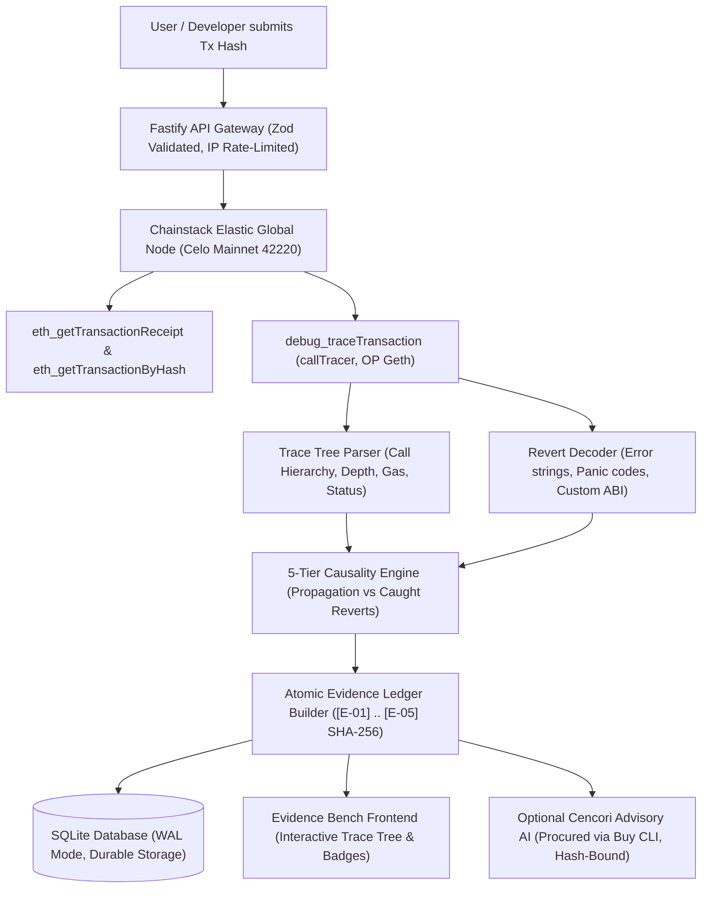

# RevertLens

**"Your Celo transaction failed. Find out why."**

RevertLens is an evidence-based forensic investigation platform for Celo Mainnet (`eip155:42220`). When smart contract transactions revert, standard blockchain explorers show generic `"execution reverted"` strings or raw hex bytes without explaining which sub-call failed, whether an error was handled, or why state changes were rolled back.

RevertLens connects directly to an archive Celo OP Geth node, parses nested execution call trees via `debug_traceTransaction` with `callTracer`, decodes Solidity reverts and panics, evaluates continuous failure propagation to isolate caught internal errors from root causes, constructs an immutable cryptographic SHA-256 evidence ledger (`[E-01]` to `[E-05]`), and provides transparent, evidence-led diagnosis reports with SQLite persistence and exportable JSON reports.

---

## 1. Demo and Key Links

| Resource | Link / Status | Description |
|:---|:---|:---|
| **Live Web Application** | *Pending public deployment (Scheduled in MOD-06)* | Full-stack deployment on cloud container with persistent storage |
| **Demo Video** | *Pending recording ([DEMO_SCRIPT.md](DEMO_SCRIPT.md) ready)* | 3-minute forensic walkthrough on Celo Mainnet |
| **GitHub Repository** | [github.com/Harshal-Pande/openHackathonPS3](https://github.com/Harshal-Pande/openHackathonPS3) | Official public repository for Track PS3 |
| **API Health Check** | `GET /api/health` | Automated server status, memory, and database connectivity |
| **Agent Metadata** | `GET /api/agent/metadata` | Public ERC-8004 agent registration metadata document |
| **Registration Preview** | `GET /api/agent/erc8004-registration-tx` | Pre-computed tagged registration transaction payload |
| **Target Blockchain** | [Celo Mainnet Explorer](https://celoscan.io) | Chain ID `42220` (`0xa4ec`) |
| **Canonical ERC-8004 Registry** | [`0x8004A169...a432` on Celoscan](https://celoscan.io/address/0x8004A169FB4a3325136EB29fA0ceB6D2e539a432) | Canonical Celo Identity Registry (ERC-1967 proxy) |
| **Official Agent Wallet** | [`0x3e1bef...8e52` on Celoscan](https://celoscan.io/address/0x3e1bef07824cd0E076F4907641F0A0EF27898e52) | Identity Owner and Buy Payment Wallet |

---

## 2. On-Chain Evidence & Verification Matrix

| Evidence Item | Value | Verification Reference |
|:---|:---|:---|
| **Target Network** | Celo Mainnet (`eip155:42220`) | [Celoscan](https://celoscan.io) / RPC `eth_chainId` (`0xa4ec`) |
| **Sample Reverted Transaction** | `0xb90bcca5d39501ca3978b5938fc6ffc47f73b393978c4515baf4c491d4509445` | [Celoscan Tx 0xb90bcca5...](https://celoscan.io/tx/0xb90bcca5d39501ca3978b5938fc6ffc47f73b393978c4515baf4c491d4509445) / [Blockscout](https://explorer.celo.org/mainnet/tx/0xb90bcca5d39501ca3978b5938fc6ffc47f73b393978c4515baf4c491d4509445) |
| **Sample Revert Block** | `52460432` | Mined block containing reverted transaction |
| **Sample Revert Data** | `Error(string)`: `"Swap reverted"` | Selector `0x08c379a0`, verified by revert decoder |
| **ERC-8004 Identity Registry** | `0x8004A169FB4a3325136EB29fA0ceB6D2e539a432` | [Celoscan Contract](https://celoscan.io/address/0x8004A169FB4a3325136EB29fA0ceB6D2e539a432) |
| **Registry Implementation** | `0x7274e874ca62410a93bd8bf61c69d8045e399c02` | [Celoscan Implementation](https://celoscan.io/address/0x7274e874ca62410a93bd8bf61c69d8045e399c02) |
| **Official Agent Wallet** | `0x3e1bef07824cd0E076F4907641F0A0EF27898e52` | [Celoscan Address](https://celoscan.io/address/0x3e1bef07824cd0E076F4907641F0A0EF27898e52) |
| **ERC-8021 Attribution Tag** | `celo_235f6ef56f5b` | Assigned builder tag for Track PS3 (Schema 0, 35-byte suffix) |
| **ERC-8004 Identity Status** | `PREPARED_NOT_REGISTERED` | Token ID: `NOT_REGISTERED` (Calldata generated; minting scheduled in MOD-05B) |
| **Build with Buy Settlement** | `PENDING_OPERATOR_FUNDING` | Software adapter verified in tests; zero personal spend ($0.00 spent) |
| **Custom Deployed Contract** | *None (Application-Level Forensic Agent)* | RevertLens does not deploy a custom user contract; it interacts with Celo protocols |

---

## 3. How RevertLens Works

When an EVM transaction reverts, the root transaction receipt simply indicates `status: 0`. The actual failure often occurs several call levels deep inside a third-party liquidity pool, oracle, or token transfer.



### Forensic Pipeline Stages:
1. **Transaction & Receipt Retrieval:** Obtains sender, recipient, gas limits, gas used, and status from Celo Mainnet.
2. **Deep Call Trace Ingestion:** Fetches the full call hierarchy using `debug_traceTransaction` with `callTracer` on an OP Geth archive node.
3. **Solidity Error & Panic Decoding:** Parses standard `Error(string)` (`0x08c379a0`), `Panic(uint256)` (`0x4e487b71`), and custom error selectors.
4. **Causality Classification:** Distinguishes internal reverts that were safely handled in Solidity `try/catch` blocks from true unhandled errors that propagated up the call stack to cause the top-level revert.
5. **Cryptographic Evidence Ledger:** Compiles facts into immutable evidence items `[E-01]` through `[E-05]`, each anchored with a SHA-256 digest calculated over normalized source data.
6. **Transparent Diagnosis Presentation:** Renders the failing frame hierarchy on the Evidence Bench with deepest failing call badges and exportable JSON report files.
7. **Advisory AI (Optional):** Cencori LLM inference can be unlocked via the Buy marketplace (`@celo/buy`). The AI is strictly advisory; all causal claims are verified against the deterministic evidence ledger before display.

---

## 4. Technology Stack

- **Runtime & Language:** Node.js 22 LTS (requires `>=22.0.0` for native `node:sqlite`), TypeScript 5.7 (strict mode).
- **Backend Framework:** Fastify 5 with standard JSON envelopes, IP sliding-window rate limiting, and strict Zod boundary validation.
- **Frontend Framework:** React 19 + Vite 6 modular SPA with vendor code-splitting (`vendor-react`, `vendor-icons`), accessible high-contrast UI, and JSON export.
- **Blockchain Connectivity:** Direct RPC requests to a dedicated Chainstack Celo Mainnet Elastic Global Node (OP Geth, chain ID 42220) with URL redaction and rate-limit backoff.
- **Attribution Engine:** `@celo/attribution-tags` (ERC-8021) enforcing Schema 0 calldata suffix injection for outgoing transactions and strict isolation for read-only RPC.
- **Agent Identity Standard:** ERC-8004 metadata synthesis (`/api/agent/metadata`), calldata generation for `register(string agentURI)` on registry `0x8004A169...`, and forensic receipt verification.
- **Marketplace & Payments:** `@celo/buy` CLI integration for capability discovery and x402-v2 quote generation with immutable request-body SHA-256 bindings.
- **Database & Storage:** Native Node.js SQLite (`node:sqlite`) with Write-Ahead Logging (`PRAGMA journal_mode = WAL`) and automatic schema migrations.
- **Testing & QA:** Vitest 3 test runner, Chrome DevTools Protocol (CDP) automated browser testing on Desktop and Mobile viewports, and route injection verification scripts.

---

## 5. Installation and Fresh-Clone Setup

Follow these exact steps to run RevertLens from a fresh repository clone:

### Prerequisites:
- **Node.js:** `>=22.0.0` LTS (verify with `node -v`).
- **npm:** `>=10.0.0` (verify with `npm -v`).
- **Operating System:** Linux, macOS, or Windows (PowerShell / Command Prompt).

### Quickstart Commands:

```bash
# 1. Clone the repository
git clone https://github.com/Harshal-Pande/openHackathonPS3.git
cd openHackathonPS3

# 2. Install dependencies cleanly from lockfile
npm ci

# 3. Configure environment variables
cp .env.example .env

# 4. Verify static types and automated test suite
npm run typecheck
npm test

# 5. Build production server and client bundles
npm run build

# 6. Launch production server
npm start
```

### Accessing the Application:
- **Web Frontend:** Open [http://localhost:3000](http://localhost:3000) in any web browser.
- **API Health Check:** Send a GET request to verify server startup:
  ```bash
  curl http://localhost:3000/api/health
  ```
  Expected response: `{"status":"ok","uptime":...,"timestamp":...}`.
- **Agent Metadata Endpoint:** Inspect the public ERC-8004 registration document:
  ```bash
  curl http://localhost:3000/api/agent/metadata
  ```

### Environment Variable Guide (`.env`):
For complete documentation, see [`.env.example`](.env.example). The essential variables are:

| Variable | Default Value | Purpose |
|:---|:---|:---|
| `PORT` | `3000` | HTTP listening port for Fastify server |
| `HOST` | `127.0.0.1` | Local listening host (`0.0.0.0` in Docker) |
| `DATABASE_PATH` | `./data/revertlens.sqlite` | SQLite database file location |
| `PUBLIC_BASE_URL` | `http://localhost:3000` | Canonical public URL used for metadata generation |
| `CHAINSTACK_CELO_MAINNET_RPC_URL` | *(Optional for unit tests)* | Celo OP Geth archive node URL for live investigations |
| `CELO_ATTRIBUTION_TAG` | `celo_235f6ef56f5b` | Official immutable hackathon builder tag |
| `AGENT_WALLET_ADDRESS` | `0x3e1bef...8e52` | Official immutable agent wallet address |

> [!NOTE]
> All unit and integration test suites (`npm test`) run **100% offline** without requiring a live Chainstack RPC endpoint or API keys. To run live on-chain investigations from the UI against arbitrary Celo Mainnet transactions, provide an archive Celo RPC endpoint in `CHAINSTACK_CELO_MAINNET_RPC_URL`.

---

## 6. Automated Verification

Judges can execute the entire automated QA and verification pipeline using these commands:

```bash
# 1. Static typecheck across server and client
npm run typecheck

# 2. Automated test suite (Vitest)
npm test

# 3. Production asset compilation
npm run build

# 4. Route surface injection audit (36 scenarios across 25 endpoints)
node scripts/verify_all_routes.mjs

# 5. Real browser Chrome DevTools Protocol (CDP) test (Desktop & Mobile)
node scripts/browser_e2e_cdp.mjs

# 6. Git whitespace and conflict check
git diff --check

# 7. Generate and independently verify repository snapshot & manifests
npm run gitingest:check
```

### Latest Verified Test Execution Results:
- **TypeScript Typecheck:** `0 errors` (Server `tsconfig.server.json` & client `tsconfig.client.json`).
- **Vitest Test Suite:** **23 test files passed, 514/514 tests passed (100% pass rate)** in ~16.0 seconds.
- **Route Surface Verification:** **36/36 scenarios passed** across 25 unique Fastify endpoints.
- **Browser Automation (CDP):** **100% assertions passed** on Desktop (1280x800) and Mobile (375x812) viewports.
- **Full Results Log:** Documented in [`TEST_RESULTS.md`](TEST_RESULTS.md).

---

## 7. Real Celo Transaction Walkthrough

To verify RevertLens on real Celo Mainnet data, investigate the verified candidate transaction:

- **Transaction Hash:** `0xb90bcca5d39501ca3978b5938fc6ffc47f73b393978c4515baf4c491d4509445`
- **Celo Explorer Links:**
  - [View on Celoscan](https://celoscan.io/tx/0xb90bcca5d39501ca3978b5938fc6ffc47f73b393978c4515baf4c491d4509445)
  - [View on Celo Blockscout](https://explorer.celo.org/mainnet/tx/0xb90bcca5d39501ca3978b5938fc6ffc47f73b393978c4515baf4c491d4509445)
- **Block Number:** `52460432`
- **Sender:** `0x6bFc49bAd93465d272E9EF2aFb4960245B62b5Ea`
- **Recipient Router:** `0xd0Bebd199e4a115C4Ddd04351e57913B2fE9b6a0`
- **What Explorers Show:** Status `Fail`, Revert Reason `Error(string)` `"Swap reverted"`.

### What RevertLens Reveals (Depth-by-Depth Forensic Analysis):
RevertLens ingests the full execution trace (4 call frames, max depth 2) and isolates the exact failure propagation:
1. **Frame 0 (Depth 0 - CALL):** Top-level call to Uniswap-style Router `0xd0be...` reverted with `"Swap reverted"`.
2. **Frame 0.0 (Depth 1 - STATICCALL):** Query to token contract `0x765d...` (`balanceOf`) **succeeded**.
3. **Frame 0.0.0 (Depth 2 - DELEGATECALL):** Internal proxy call **succeeded**.
4. **Frame 0.1 (Depth 1 - CALL):** Sub-call to pair pool `0xe3d8bd6aed4f159bc8000a9cd47cffdb95f96121` calling `swapExactETHForTokens` **reverted** with `"execution reverted"`.
5. **Causality Verdict:** The root router contract did not handle the pair revert; the failure propagated unhandled up the call stack to cause the entire transaction to revert.
6. **Evidence Ledger Generated:**
   - `[E-01]` Transaction fact: gas limit `5,000,000`, sender, and recipient.
   - `[E-02]` Receipt fact: block `52460432`, gas used `54,232`, status `REVERTED`.
   - `[E-03]` Revert data: selector `0x08c379a0`, decoded message `"Swap reverted"`.
   - `[E-04]` Trace structure: 4 total frames, depth 2.
   - `[E-05]` Causality proof: deepest failing frame at depth 1 (`0xe3d8...`).

---

## 8. Celo Attribution & ERC-8004 Identity

RevertLens adheres strictly to the official Celo hackathon standards:

### ERC-8021 Attribution Tagging:
- **Assigned Tag:** `celo_235f6ef56f5b` (registered for Track PS3).
- **Standard:** Official `@celo/attribution-tags` (ERC-8021 Schema 0).
- **Calldata Suffix:** `0x63656c6f5f323335663665663536663562110080218021802180218021802180218021` (35 bytes).
- **Policy:** Injected on outgoing state-changing transactions; strictly prohibited and guarded on read-only RPC calls (`ChainstackProvider.callRpc`).

### ERC-8004 Agent Identity Preparation:
- **Identity Registry Contract:** `0x8004A169FB4a3325136EB29fA0ceB6D2e539a432` on Celo Mainnet ([Celoscan](https://celoscan.io/address/0x8004A169FB4a3325136EB29fA0ceB6D2e539a432)).
- **Identity Proxy Architecture:** ERC-1967 proxy resolving to implementation `0x7274e874ca62410a93bd8bf61c69d8045e399c02`. View methods verified on-chain: `name()` returns `"AgentIdentity"`, `symbol()` returns `"AGENT"`.
- **Function Selector:** `0xf2c298be` (`register(string agentURI)`).
- **Registration Readiness:** Endpoint `GET /api/agent/erc8004-registration-tx` evaluates the canonical base URL:
  - When hosted on `localhost` or private IP: returns `BLOCKED_PENDING_PUBLIC_DEPLOYMENT`.
  - When hosted on a verified public HTTPS domain: returns `READY_FOR_OPERATOR_SIGNATURE`.
- **Receipt Verifier:** Automated engine `verifyErc8004RegistrationReceipt()` decodes `Registered` and `Transfer` mint events to record the minted `agentId`.
- **Detailed Runbook:** See [`ERC8004_REGISTRATION_PREPARATION.md`](ERC8004_REGISTRATION_PREPARATION.md).

---

## 9. Build with Buy Integration (Track PS3)

RevertLens implements the official `@celo/buy@0.8.5` architecture for autonomous service procurement:

- **Procured Service:** Cencori LLM inference (`cencori.v1.chat.completions`) for advisory explanations of complex reverts.
- **Security Invariant:** Public users cannot trigger project wallet spending. Purchases require an authenticated operator session.
- **Cryptographic Binding:** The outbound request body is hashed via SHA-256 before quote creation. The operator approves the exact tuple `(quoteId, bodySha256, maxAmountAtomic, payeeAddress, tokenContract, network)`. Any body mutation permanently invalidates the approval.
- **CLI Subprocess Isolation:** The Buy CLI is invoked with fixed argument arrays (`shell: false`), strict timeouts, and credential redaction.
- **Atomic Budget Reservation:** SQLite transactions (`BEGIN IMMEDIATE`) atomically reserve spending budget prior to CLI execution, preventing race-condition overages.
- **Settlement Verification:** Proof of settlement requires parsing on-chain transaction receipt logs for ERC-20 Transfer events matching quoted token, recipient, and exact atomic amount.
- **Zero-Spend Status:** Current spend across all phases is strictly **$0.00**. On-chain settlement requires human operator wallet funding.

---

## 10. Security and Privacy Model

- **Read-Only Forensic Core:** RevertLens is an analysis platform. It never requests, stores, or handles private keys, seed phrases, or wallet exports.
- **Decoupled Operator Authentication:** Operator passwords are authenticated using salted scrypt hashes ($N=16384, r=8, p=1$), completely separated from session signing secrets.
- **Capacity & DoS Protections:** Hard bounds on active sessions (5,000 max), fail-closed IP sliding-window rate limiting, and scrypt memory validation against a 64 MiB ceiling.
- **Read-Only RPC Gateway Isolation:** Authoritative allowlist of 20 approved read-only RPC methods; state-changing RPC methods (`eth_sendTransaction`, etc.) are rejected at the gateway boundary.
- **Privacy by Default:** Investigation reports are unlisted by default. User IP addresses and transaction hashes are sanitized.
- **Comprehensive Threat Model:** See [`SECURITY.md`](SECURITY.md).

---

## 11. Authoritative Documentation Index

All documentation is maintained with clean relative links:

- **Audit & Governance:**
  - [`MASTER_PROJECT_AUDIT.md`](MASTER_PROJECT_AUDIT.md) — Definitive technical, architectural, and security audit.
  - [`MASTER_EXECUTION_ROADMAP.md`](MASTER_EXECUTION_ROADMAP.md) — Critical-path module roadmap (`MOD-01` through `MOD-08`).
  - [`MASTER_CHANGELOG.md`](MASTER_CHANGELOG.md) — Unified chronological changelog (Phases 0 through 26 / MOD-06.1 Docker & Runtime Verification).
  - [`MASTER_DEFECT_REGISTER.md`](MASTER_DEFECT_REGISTER.md) — Defect register tracking all 59 historical findings to resolution.
  - [`SUBMISSION_CHECKLIST.md`](SUBMISSION_CHECKLIST.md) — Pre-flight compliance and release gate checklist.
- **Technical & Security Specifications:**
  - [`SECURITY.md`](SECURITY.md) — Core security policies, key invariants, and threat mitigations.
  - [`TEST_RESULTS.md`](TEST_RESULTS.md) — Automated test results matrix and route injection evidence.
  - [`PROOF.md`](PROOF.md) — Real on-chain transaction hashes and live trace proof ledger.
  - [`ERC8004_REGISTRATION_PREPARATION.md`](ERC8004_REGISTRATION_PREPARATION.md) — 18-point ERC-8004 agent registration audit.
  - [`CELO_DEVREL_FEEDBACK_CLOSURE.md`](CELO_DEVREL_FEEDBACK_CLOSURE.md) — Hands-on closure of Celo DevRel review findings.
- **Operational Runbooks:**
  - [`JUDGE_LOCAL_RUNBOOK.md`](JUDGE_LOCAL_RUNBOOK.md) — Step-by-step judge reproduction guide for fresh clones.
  - [`DEPLOYMENT_READINESS.md`](DEPLOYMENT_READINESS.md) — Docker container and cloud deployment guide for operators.
  - [`DEMO_SCRIPT.md`](DEMO_SCRIPT.md) — 3-minute video presentation script.
